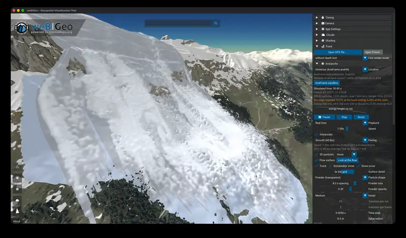
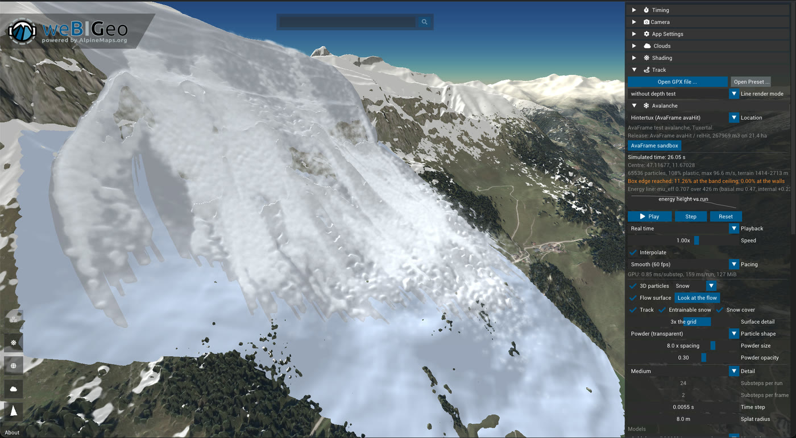
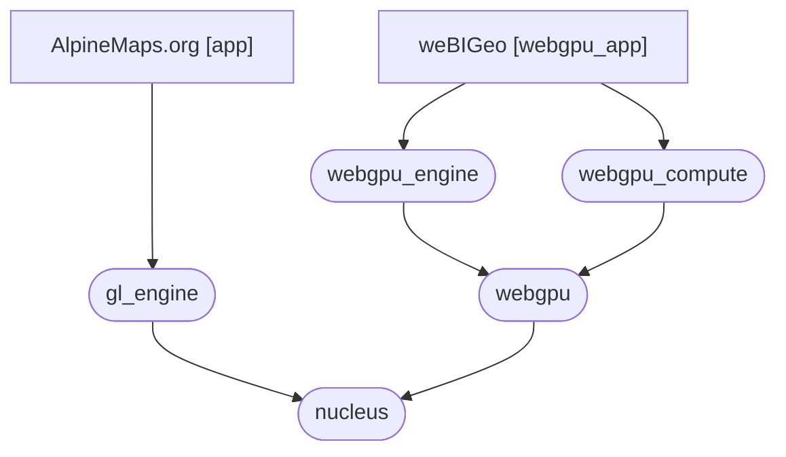

# MLS-MPM avalanche simulation in weBIGeo

A physical snow avalanche simulation that runs on the GPU inside [weBIGeo](https://webigeo.alpinemaps.org/),
on weBIGeo's own terrain, in the browser and in the native app. It is a Moving Least Squares Material
Point Method (MLS-MPM) solver written in WGSL compute shaders, with a 3D rendering of the flow on the map
and a comparison against AvaFrame, the open-source avalanche toolkit. This fork of
[weBIGeo/webigeo](https://github.com/weBIGeo/webigeo) is the TU Wien Visual Computing project
(WS26) that adds it.

[](assets/demo_mpm_hintertux.mp4)

*The Hintertux avalanche (AvaFrame's avaHit release area) on weBIGeo's terrain, played in real time.
Click for the [video](assets/demo_mpm_hintertux.mp4).*



**Try it in the browser:** [emanum.github.io/webigeo/wasm_mt_lto/webgpu_app.html](https://emanum.github.io/webigeo/wasm_mt_lto/webgpu_app.html)
(release build, multithreaded, link-time optimised; needs a browser with WebGPU, e.g. a current Chrome
or Edge). The simulation loads at launch; add [`?avalanche=play`](https://emanum.github.io/webigeo/wasm_mt_lto/webgpu_app.html?avalanche=play)
to start it playing, `?avalanche=0` to skip it. On the very first visit the page may need one reload
(a service worker enables the cross-origin isolation the threads need). Every build of `main` is
deployed to [emanum.github.io/webigeo](https://emanum.github.io/webigeo/).

**First visit: download the AvaFrame data once.** The AvaFrame test avalanches are not shipped with the
app (their data has no licence for redistribution), so the browser fetches them from AvaFrame's GitHub
repository:
1. In the **Avalanche** panel (sidebar), click **AvaFrame sandbox**.
2. Click **Download AvaFrame data...** and confirm with **Download**. It takes a moment (about 40 MB).
3. Click **Back to the map**.

The data stays in the browser (IndexedDB), so this is needed once per browser. Without it the sandbox
has no datasets, and the AvaFrame locations on the map release a disc of the same area instead of
AvaFrame's release areas.

**Full documentation:** [mpm-mls-doc/](mpm-mls-doc/README.md): theory, files and API, shaders, data
layout, tuning, verification, performance, rendering, the AvaFrame comparison, and the current state
and limitations.

## What it adds

- **The solver** (`webgpu/compute/nodes/MpmSolverNode`, `webgpu/compute/shaders/mpm_*.wgsl`): MLS-MPM on a
  terrain-following grid that covers a whole avalanche path; three exchangeable snow materials
  (Stomakhin, Drucker–Prager, Cohesive Cam Clay), Coulomb and Voellmy basal friction, and entrainment of
  the snow cover.
- **Playback** (`webgpu/compute/SimulationDriver`, `SimulationClock`, `TimeSteppedSimulation`): real time
  at 0.1–4× with interpolation, or as fast as the GPU allows. Not MPM specific; see
  [docs/time_stepped_simulations.md](docs/time_stepped_simulations.md) for adding another simulation.
- **3D rendering on the map** (`webgpu/engine/avalanche/AvalancheRenderer`): a draped flow surface, the
  track, the snow cover, and the particles as powder, ellipsoids or spheres.
- **AvaFrame integration** (`apps/webgpu_app/avalanche/`): AvaFrame's five real test avalanches,
  downloaded at runtime, as a sandbox on AvaFrame's terrain (compared live with com1DFA's results) and as
  release areas on the map.
- **An Avalanche panel** in the app's sidebar: locations, materials, playback, entrainment, the sandbox.

## Run it

Build the app as described in [docs/webgpu_app.md](docs/webgpu_app.md). On macOS, with Qt 6.11.1 in
`~/Qt/6.11.1/macos`:

```bash
cmake --preset webgpu_app_macos_release
cmake --build build/webgpu_app_macos_release
open build/webgpu_app_macos_release/apps/webgpu_app/webgpu_app.app
```

In the app, open the **Avalanche** panel in the sidebar:
- **Load the MLS-MPM simulation**, pick a **Location** and press **Play**: an avalanche on the map.
- **Load the AvaFrame sandbox** (or **AvaFrame sandbox** when the simulation is already loaded), then
  **Download AvaFrame data...** the first time: a run on one of AvaFrame's avalanches next to com1DFA's
  result. The download also gives the AvaFrame locations on the map their real release areas.

## State

The solver runs end to end in the native app and in the browser. Every shader formula was checked
against its source paper, and the solver is tested with Python reference implementations, GPU golden
tests and a whole-kernel test ([06-verification.md](mpm-mls-doc/06-verification.md)). On an Apple M5 the
preset (65 536 particles) takes 6.4 ms of GPU time per 24 substeps
([09-performance-analysis.md](mpm-mls-doc/09-performance-analysis.md)).

Limits: at 5–12.5 m grid cells the released slab is thinner than a cell, so the flow reads more fluid
than slab-like; the flows run about twice as fast as com1DFA's with the same friction; there is no
validation against observed avalanches, only against com1DFA. For education, not for hazard
assessment.

> **AI assistance.** The implementation and its documentation were written with Claude (Anthropic),
> directed by the project author; see [mpm-mls-doc/README.md](mpm-mls-doc/README.md).

---

*The rest of this file is the README of the upstream repository.*

#  AlpineMaps.org

 [](https://alpinemaps.org) [](https://webigeo.alpinemaps.org/) [](https://discord.gg/p8T9XzVwRa)

This is a mono-repository containing the [AlpineMaps.org](https://alpinemaps.org) and [weBIGeo](https://webigeo.alpinemaps.org/) projects alongside their shared dependencies. Both are under active development and aim to provide state-of-the-art real-time rendering and processing for large-scale, tile-based geodata.

###  [AlpineMaps.org (`app`)](docs/app.md)
Qt Quick / OpenGL frontend, the original alpinemaps.org client.

###  [weBIGeo (`webgpu_app`)](docs/webgpu_app.md)
WebGPU rendering engine with ImGui UI and GPU compute graph.

[If looking at the issues, best to filter out projects!](https://github.com/AlpineMapsOrg/renderer/issues?q=is%3Aissue%20state%3Aopen%20no%3Aproject)

We are in discord, talk to us!
https://discord.gg/p8T9XzVwRa


## Architecture



*...only top-level dependencies are shown.*

| Module | Description |
|--------|-------------|
| [`nucleus`](docs/camera_controls.md) | Shared core: tile management, camera, data structures |
| [`webgpu`](docs/webgpu_base.md) | RAII WebGPU wrappers (device, pipelines, buffers), WGSL preprocessor and GPU resource registry |
| `gl_engine` | OpenGL rendering engine (used by the QML app) |
| [`webgpu_engine`](docs/webgpu_engine.md) | WebGPU rendering engine (used by the webgpu_app) |
| `webgpu_compute` | CPU/GPU compute node graph library |

## Code style
* class names are CamelCase, method, function and variable names are snake_case.
* class attributes have an m_ prefix and are usually private, struct attributes don't and are usually public.
* "use `void set_attribute(int value)` and `int attribute() const` for setters and getters (that is, avoid the get_)." Use [the Qt recommendations](https://wiki.qt.io/API_Design_Principles#Naming_Boolean_Getters,_Setters,_and_Properties) for naming boolean getters.
* structs are usually small, simple, and have no or only few methods. they never have inheritance.
* files are CamelCase if the content is a CamelCase class. otherwise they are snake_case, and have a snake_case namespace with stuff.
* the folder/structure.h is reflected in namespace folder::structure{ .. }
* indent with space only, indent 4 spaces
* ideally, use the clang-format file provided with the project
  (in case you use Qt Creator, go to Preferences -> C++ -> Code Style: Formatting mode: Full, Format while typing, Format edited code on file save, don't override formatting)
* follow the [Qt recommendations](https://wiki.qt.io/API_Design_Principles) and the [c++ core guidelines](https://isocpp.github.io/CppCoreGuidelines/CppCoreGuidelines) everywhere else.

## Developer workflow
* Fork this repository.
* Enable github pages from actions (Repository Settings -> Pages -> Source -> GitHub Actions)
* Work in branches or your main.
* Make pull requests from your main branch.
* Github Actions will run the unit tests and create packages for the browser and Android and deploy them to your_username.github.io/your_clone_name/.
* Make sure that the unit tests run through.
* We will also look at the browser version during the pull request.
* Ideally you'll also setup the signing keys for Android packages. ([instructions](docs/app_creating_apk_keys.md)).
