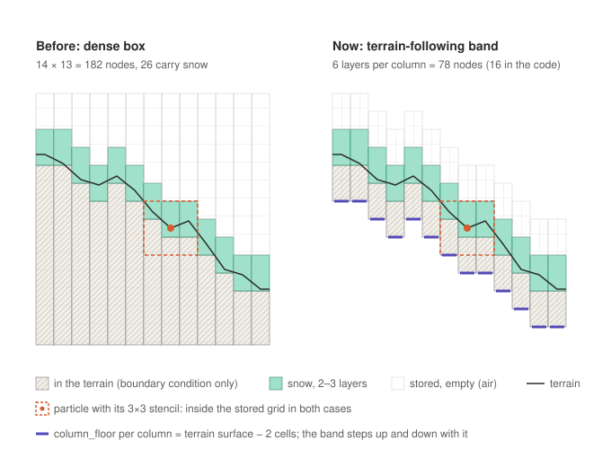

# Data layout and conventions

## Coordinates

| Quantity | Convention |
|---|---|
| `particle.position.xy` | Metres on the ground from the min corner of the region AABB |
| `particle.position.z` | Absolute altitude [m] |
| Texture UV | u along +x, v along −y (`v = 1 − y / region_size.y`, row 0 north); only through `world_to_uv()` |
| Grid space | `(position.xy − domain_origin) / dx`; `position.z / dx` (absolute altitude in cells) |
| Domain and release centres | Latitude/longitude (`glm::dvec2(lat, lon)`), converted in `update_gpu_settings()` |
| Metres | World units × cos(latitude of the region centre); `region_size` in the uniform is in metres |

## Layout version

`MPM_LAYOUT_VERSION` (`MpmSolverNode.h`) versions the layouts read outside the solver: `Particle`
and `ColumnStats` (`mpm_common.wgsl`), `grid_velocity`, `column_floor`. `MpmParticleView` and
`MpmRawView` carry it as `layout_version`. On a layout change:

1. Bump `MPM_LAYOUT_VERSION`.
2. Update the renderer's constants (`PARTICLE_STRIDE_VEC4`, `COLUMN_STATS_STRIDE_U32`) and
   `AvalancheRenderer::SOLVER_LAYOUT_VERSION`; `ParticleRenderNode.cpp` `static_assert`s that
   both versions match.
3. Update this file and [16-raw-grid-view.md](16-raw-grid-view.md).

## `Particle` (128 B)

```wgsl
struct Particle {
    position: vec3f,  mass: f32,           // mass 0: inactive; < 0: entrained this substep
    velocity: vec3f,  plastic_state: f32,  // per model: Stomakhin J_P, Drucker–Prager plastic strain, Cam Clay α
    c0: vec3f,        tau_xx: f32,         // c0..c2: rows of the APIC matrix C
    c1: vec3f,        tau_yy: f32,
    c2: vec3f,        tau_zz: f32,
    f0: vec3f,        tau_xy: f32,         // f0..f2: rows of the elastic deformation gradient F
    f1: vec3f,        tau_xz: f32,
    f2: vec3f,        tau_yz: f32,         // τ = P·Fᵀ (symmetric), written by G2P, read by P2G
}
```

C and F are stored as rows; access through `particle_c()`/`particle_f()` and
`store_c()`/`store_f()`. Particle mass is 1 and particle volume `settings.particle_volume` =
1/ρ for every particle.

## `GridNode` (20 B) and `grid_velocity` (16 B)

```wgsl
struct GridNode {
    mass_lo: atomic<u32>, mass_hi: atomic<u32>,        // mass, 2^20 per unit
    vx: atomic<i32>, vy: atomic<i32>, vz: atomic<i32>  // momentum, 10^4 per unit
}
```

Stride `GRID_NODE_STRIDE_U32` = 5. P2G adds, the grid update reads and zeroes.
`grid_velocity: array<vec4f>`: `xyz` velocity [m/s], `w` node mass in particle-mass units, 0
for nodes without mass.

## `tile_flags`

| Part | Size (u32) | Content |
|---|---|---|
| Tile flags | ⌈res.x/8⌉·⌈res.y/8⌉ | Per 8×8-column tile: `TILE_FLAGGED` (set by P2G), `TILE_WAS_ACTIVE` (set by the grid update) |
| Sort counts and cursors | 2·(⌈res.x/4⌉·⌈res.y/4⌉ + 1) | Per 4×4-column sort tile, plus one bucket for inactive particles |
| Sorted indices | particles | Particle indices in tile order |

## Fixed-point atomics

```wgsl
const MOMENTUM_SCALE: f32 = 10000.0;   // i32, rounded, clamped to ±MOMENTUM_LIMIT (2e9) before every add
const MASS_SCALE: f32 = 1048576.0;     // 2^20, u32 lo/hi pair, carry from atomicAdd's return value
```

Momentum range per node: particles per node × speed < 2·10⁵.

## `ColumnStats` (24 B)

| Field | Type | Written by |
|---|---|---|
| `peak_depth`, `peak_speed` | f32 | `mpm_grid_update` |
| `particles`, `speed_sum` [cm/s] | atomic u32 | `mpm_column_stats` (sandbox), zeroed by `mpm_grid_update` |
| `cover`, `eroded` | f32 | `mpm_prepare`, `mpm_grid_update` (entrainment) |

## `SimState` (84 B, 21 u32)

| Slot | Field | Lifetime |
|---|---|---|
| 0–1 | `min_altitude_cm`, `max_altitude_cm` (i32) | reset |
| 2 | `active_particles` | reset |
| 3 | `max_speed_mm` | run |
| 4 | `plastic_particles` (yielded in the last substep) | substep (zeroed by P2G) |
| 5 | `seed_first_hits` | reset |
| 6–11 | `sum_x/y/z_lo/hi` (position × 10⁴) | run |
| 12–13 | `sum_speed_sq_lo/hi` (\|v\|² × 10⁵) | run |
| 14–15 | `sum_path_lo/hi` (horizontal path × 10⁵) | reset |
| 16–17 | `ceiling_contacts`, `wall_contacts` (particle-substeps) | run |
| 18 | `cover_volume` (0.01 m³) | reset |
| 19 | `entrained_particles` | reset |
| 20 | `pool_exhausted` (0.01 m³) | reset |

Written from the CPU on reset (altitudes ±INT_MAX); `reset_run_counters()` zeroes the "run"
slots before every other run. The last chunk copies the buffer into `m_state_readback`
(MapRead), mapped into `last_state()`; 64-bit pairs are joined by `wide()`. The state and
readback buffers are allocated once in the constructor.

## Uniform (240 B)

`MpmSolverSettingsUniform` (C++) mirrors `MpmSettings` (WGSL);
`static_assert(sizeof(MpmSolverSettingsUniform) == 240)`. Alignment: `vec3` 16, `vec2` 8,
scalars 4; struct alignment 16. Field groups in order:

grid/particle counts · domain origin, size, dx · region size, height texture size · dt,
gravity, particle mass, particle volume · μ₀, λ₀, ξ, θc · θs, friction, slab thickness, seed ·
raster size, domain UV · domain UV size, `seed_anywhere`, splat radius · density reference,
release centre, release radius · `constitutive_model`, `basal_friction_model`, `voellmy_xi`,
`dp_alpha` · `ccc_m`, `ccc_beta`, `ccc_xi`, `ccc_p0_initial` · `release_mode`, `release_volume`,
`release_max_depth`, `release_half_y` · `entrainment_mode`, `cover_mode`, `release_particles`,
`pool_particles` · `cover_thickness`, `cover_cos_max_slope`, `cover_density_ratio`,
`erosion_energy` · `plowing_depth`, `entrainment_min_speed`, `snow_density`,
`entrainment_density`.

No padding slots are free; a new field grows the struct to 256 B.

## Buffer sizes

| Buffer | Size |
|---|---|
| particles | (particles + pool) × 128 B; pool = `pool_size` × release particles with entrainment, else 0 |
| previous particles | particles × 128 B (real-time playback) |
| grid | res.x · res.y · layers × 20 B |
| grid_velocity | res.x · res.y · layers × 16 B |
| column_floor | res.x · res.y × 4 B |
| column_stats | res.x · res.y × 24 B |
| tile_flags | see above |
| state | 84 B |
| density raster | `raster_resolution`² × 4 B |

All solver buffers: `Storage | CopyDst | CopySrc`. `ensure_resources()` reallocates when the
particle count, grid resolution or raster resolution changes, and then forces a reset.

## The terrain-following grid



Each (x, y) column stores `grid_layers` node layers starting two cells below its terrain:

```
column_floor[column] = floor(terrain(node_xy) / dx) − 2        absolute z index of layer 0
slot(node)           = layer · res.x · res.y + column,  layer = node.z − column_floor[column]
```

`column_floor` is written by `mpm_prepare` once per reset. `grid_slot()` (`mpm_common.wgsl`)
returns −1 outside the band; P2G and G2P skip those nodes. `mpm_grid_update` iterates
(x, y, layer) and gets the altitude from `column_node_world()`. `mpm_g2p` keeps particles below
`(column_floor + layers − 2.5) · dx`.
