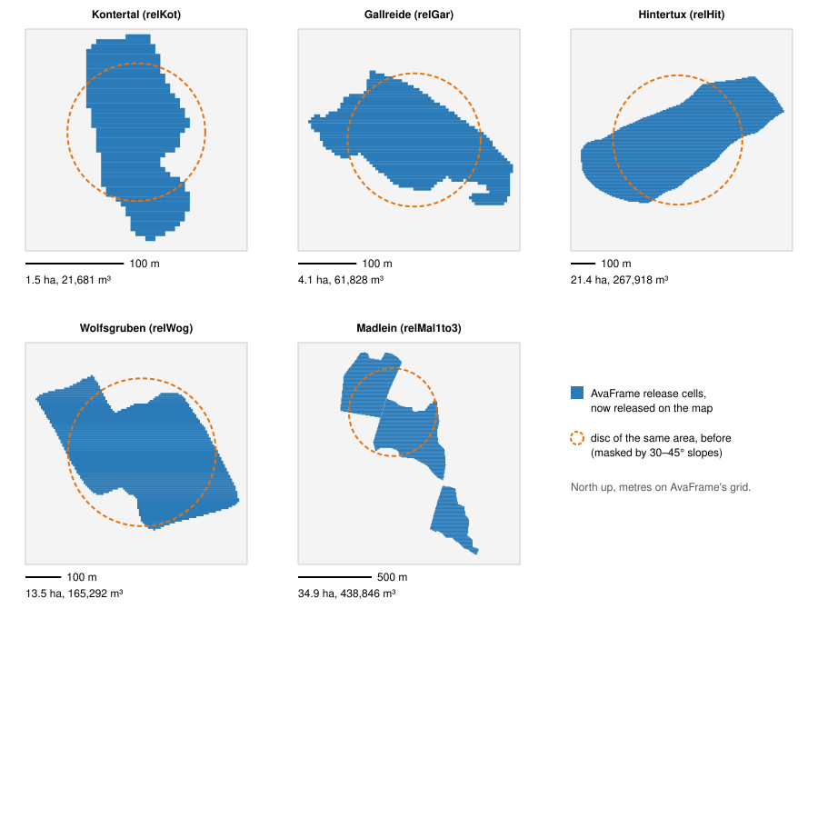

# AvaFrame release areas on the map

The five AvaFrame test avalanches of the comparison ([11-avaframe-comparison.md](11-avaframe-comparison.md))
also exist as map scenarios (Kontertal, Gallreide, Hintertux, Wolfsgruben, Madlein), for watching
them in real time on weBIGeo's terrain. Until 2026-10-24 they released a disc of the same area on
the release area's centroid, masked by the map's own 30–45° release slopes. Now they release from
AvaFrame's actual release areas, like the AvaFrame sandbox — as an approximation, because the
release lives in another coordinate system and on another DEM.



*Made by `avaframe/tools/map_release_figure.py` from the prepared datasets.*

## Decisions

| Topic | Decision |
|---|---|
| Data missing | AvaFrame's areas when the AvaFrame data is downloaded (sandbox download), else the disc as before; the panel says which. |
| Slope mask | AvaFrame's areas as they are. The 30–45° mask stays for the generic disc scenarios. |
| Depth | AvaFrame's thickness per cell as vertical depth, with AvaFrame's slope (exactly as the sandbox). |
| Release scenario | Picker in the panel (only avaGar has several: relGar, relGar2, relGar6); default the comparison's. |

## Pipeline

```
Select Tiles ── region aabb ──→ AvaFrame Release ── release area ──→ MPM Solver
                                  │                                    (release grid mode,
                                  │ load_sandbox_terrain()              like the sandbox)
                                  │ resample_release()
                                  └ R32Float depth texture over the region
```

1. **Load** (`load_sandbox_terrain()`, the CPU side of `AvaFrameSandboxNode`, factored out):
   dataset.json, DEM, the release raster as vertical depth (`thickness / cos(slope)` on AvaFrame's
   DEM), and the placement `sandbox_to_world`.
2. **Resample** (`resample_release()`): a grid over the whole map region at the dataset's cell
   size (≈ 5 m, at most 4096 texels per side), laid out like the height texture (row 0 north).
   Every texel centre goes region metres → world → `inverse(sandbox_to_world)` → the dataset's
   grid; the texel takes the nearest cell's depth. Also: bounds, area, volume, max depth, centroid.
3. **Solver**: with a `ReleaseArea` on its optional "release area" input it uses its release grid
   mode — the sandbox's — on the map: the depth texture takes the release point mask's binding,
   seeding samples the bounds and keeps a sample with probability depth / max depth, every
   particle stands for volume / particles. Without one, the disc as before.

`AvaFrameReleaseNode` never fails the graph: without a dataset (generic scenario, data not
downloaded, synthetic dataset) its output is null and `status()` says why.

## The coordinate chain, and what is approximate

| Step | How | Error |
|---|---|---|
| AvaFrame grid → lat/lon | The four DEM corners, from EPSG:31287 (MGI / Austria Lambert) with the inverse Lambert conic on Bessel and the Helmert "MGI to WGS 84 (8)" (pyproj in `prepare_dataset.py`, its C++ port in `AvaFrameData`), rounded to 6 decimals. | Stated accuracy of the datum shift 0.5 m; rounding ≤ 0.1 m |
| Grid → world (EPSG:3857) | An affine map least-squares fitted to the four corners (`sandbox_to_world`). Over 2–3 km both projections are conformal and nearly linear. | Largest corner residual 0.31–0.67 world units, 0.2–0.5 m |
| World → solver metres | World units × cos(latitude) at the region centre, as the solver does. | Under 0.1 % across a region |
| Cells → texels | Nearest cell at ≈ 5 m. | Volume within 0.1 % (measured) |
| **Terrain** | The release keeps AvaFrame's horizontal outline; particles sit on the *map's* terrain there. AvaFrame's DEM and weBIGeo's (AlpineMaps tiles, zoom 15) differ in source, resolution and date, so a release cell can lie on a slightly different slope or height. | Not quantified |
| **Depth** | Vertical depth from AvaFrame's slope, not the map's. On a steeper map slope the slab would be slightly thinner slope-normal than AvaFrame's 1 m. | Small (cos of the slope difference) |
| Domain | Cells outside the solver's domain are not seeded; the solver warns. None of the five is cut off. | — |

The placement is the solid part (sub-metre); the terrain underneath is where map and AvaFrame
truly differ. Exact runs stay in the AvaFrame sandbox, on AvaFrame's own DEM.

## Measured (M5, native build, the five map scenarios, data downloaded)

| Scenario | Release on the map | Dataset | Centroid on the map | Reference centroid¹ | Residual |
|---|---|---|---|---|---|
| Kontertal / relKot | 21,664 m³ on 1.52 ha | 21,681 m³ on 1.52 ha | 47.252269, 10.396048 | 47.25227, 10.39604 | 0.37 |
| Gallreide / relGar | 61,911 m³ on 4.09 ha | 61,828 m³ on 4.08 ha | 47.050459, 11.329307 | 47.05046, 11.32931 | 0.31 |
| Hintertux / relHit | 267,969 m³ on 21.39 ha | 267,919 m³ on 21.39 ha | 47.120978, 11.663908 | 47.12098, 11.66391 | 0.36 |
| Wolfsgruben / relWog | 165,334 m³ on 13.52 ha | 165,292 m³ on 13.52 ha | 47.121610, 10.288465 | 47.12161, 10.28847 | 0.42 |
| Madlein / relMal1to3 | 438,914 m³ on 34.87 ha | 438,846 m³ on 34.87 ha | 47.032131, 10.280935 | 47.03342, 10.27979² | 0.67 |

¹ The centres of the old discs: the release centroids computed independently with pyproj when the
scenarios were set up. Residual: largest corner residual of the affine fit, in world units.
² Madlein's disc sat on the largest of its three areas; the map now releases all three, so the
centroid moves 160 m. All other centroids agree to under half a metre.

- All 65,536 particles seeded in every scenario; no release reaches outside its domain.
- Without the data (sandbox root pointing at an empty folder): the panel says "a disc of the same
  area as AvaFrame's", the graph runs, the solver releases the disc.
- Unit tests (`test_ReleaseResampling.cpp`): aligned grids keep volume, area and bounds exactly;
  an offset region, Web Mercator scaling, a 15° rotation and a coarser grid keep the volume within
  5–15 %; no placement or a release outside the region gives none.

## Not done / open

- Not compared against com1DFA on the map: the runout there depends on the map's terrain, and the
  comparison stays in the sandbox.
- The picker (avaGar) was not clicked in a test; scenarios were set through the startup prefs.
- The release areas' other AvaFrame inputs (entrainment, resistance areas) are not used anywhere.
- Web build: tested in the browser by Manuel (25 Oct): the download and the map release work. The data is kept in the browser's memory, so a page reload needs the download again.
